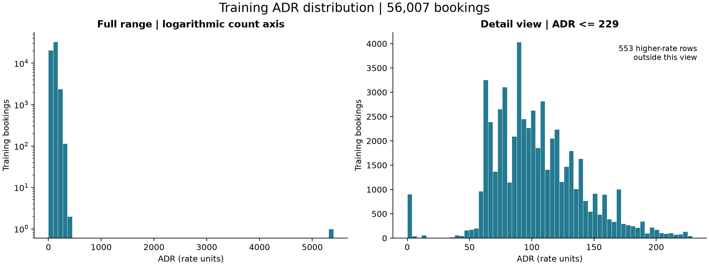
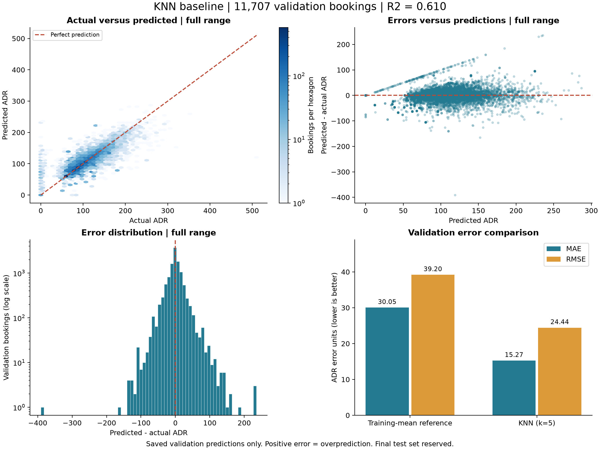

# Task A: K-Nearest Neighbors Regression — Milestone 1

**Dataset:** City Hotel (H2), 79,330 bookings and 31 source variables
**Contribution:** KNN regression baseline
**Status:** Draft for integration into the team's progress report; feature-timing and shared experimental-policy review remain pending.

## 1. Objective

Task A predicts Average Daily Rate (`ADR`) from selected booking attributes. ADR is the regression target: a numerical value, rather than a cancellation label or a cluster identifier. The dataset publication defines ADR as total lodging transactions divided by staying nights. It should therefore not be equated automatically with the price first quoted when the booking was created [1].

For Milestone 1, a fixed K-Nearest Neighbors (KNN) regressor was implemented and evaluated against a simple training-mean reference. Hyperparameter tuning, additional model families, PCA comparisons, and final test evaluation are planned for Milestone 2.

## 2. Prediction point and preliminary leakage audit

The initial design assumed that predictions would be requested at booking creation. Source verification identified a limitation: the publication generally reconstructs booking attributes relative to the day before arrival, using change logs where available [1]. Guest counts, stay duration, meal package, and room preferences may differ from their original booking-time values.

Consequently, the current experiment is an exploratory regression baseline using the supplied attributes; its scores do **not** demonstrate leakage-free prediction at booking creation. Before deployment, the team must establish a prediction point consistent with feature availability, such as a carefully audited pre-arrival estimate of eventual ADR, or obtain original booking-time histories. Changing the stated prediction point alone does not resolve every feature-timing issue.

`ADR` is excluded from predictors. `IsCanceled`, `ReservationStatus`, `ReservationStatusDate`, `AssignedRoomType`, and `BookingChanges` are also excluded to avoid supplying outcomes or later booking information under the initial design. Other unused fields were omitted to keep the baseline compact, rather than being universally classified as leakage. No filtering based on cancellation status was performed.

## 3. Selected features

| Group | Original source columns | Rationale |
| --- | --- | --- |
| Booking lead time | `LeadTime` | Allows similarity to reflect how early a booking was made. |
| Arrival timing | `ArrivalDateYear`, `ArrivalDateMonth`, `ArrivalDateDayOfMonth` | Allows calendar-related differences in rates to be represented. |
| Stay duration | `StaysInWeekendNights`, `StaysInWeekNights` | Represents the booked/stayed duration and weekday/weekend mix. |
| Guest counts | `Adults`, `Children`, `Babies` | Represents party composition. |
| Booking package and channel | `Meal`, `MarketSegment`, `DistributionChannel` | Represents package and commercial context. |
| Room category | `ReservedRoomType` | Represents the room category reserved. |

These 13 inputs are provisional, not an empirically selected optimum. Arrival month, meal, market segment, distribution channel, and reserved room type are treated as categorical. Their exact source labels are retained.

## 4. Data preparation and unusual values

Stateless cleanup removes surrounding whitespace from selected category strings. Numerical missing values are filled using training medians, followed by standardization. Categorical missing values are filled using training modes and then one-hot encoded. Previously unseen categories are handled without failing prediction. Fitted transformations and KNN are combined in a scikit-learn pipeline and fitted on training data only.

Standardization is important because KNN uses distances: lead time and guest counts have different units and numerical ranges. One-hot encoding avoids imposing an arbitrary numeric ordering on category codes. These choices define the baseline's similarity measure; they do not establish that all features have equal predictive importance.

The following audit used only the 56,007 training rows:

| Finding | Count | Baseline decision |
| --- | ---: | --- |
| Missing `Children` | 4 | Impute the training median, 0; this is an estimate, not a known child count. |
| Zero total guests | 117 | Retain and flag because the operational meaning is unverified. |
| Zero total nights | 240 | Retain and flag; all have ADR 0, whose interpretation needs clarification. |
| ADR 0 | 880 | Retain; 360 carry the `Complementary` market-segment label, which may explain some zeros. |
| ADR above 500 | 1 | Retain the value 5,400 and flag it. The publication reports the same H2 maximum [1], but this does not establish its validity. |
| More than 3 babies | 1 | Retain and flag the record with 9 babies; no verified correction is available. |

Counts overlap. The cutoffs of 500 ADR and 3 babies are exploratory review flags, not deletion thresholds. No records were deleted and no target values were clipped or corrected. The retained extreme rate may affect neighbor averages and the reference mean.



*Figure 1. Full training ADR range with a logarithmic count axis, alongside a detail view through ADR 229 (the training 99th percentile). The 553 higher-rate rows are outside the detail view only; they remain in the data and full-range panel.*

## 5. Experimental protocol

Identical cleaned predictor rows are grouped before splitting. `GroupShuffleSplit` assigns approximately 70%, 15%, and 15% of predictor groups to training, validation, and test using seed 42. Because these fractions apply to groups, row fractions are not exact.

| Partition | Bookings | Use |
| --- | ---: | --- |
| Training | 56,007 | Fit preprocessing and KNN. |
| Validation | 11,707 | Assess the baseline and reference. |
| Reserved test | 11,616 | No fitting, prediction, or metric calculation. |

Repeated records are retained, but identical input combinations cannot occur across partitions. Group construction uses predictors only, not ADR or outcome labels. This is a random grouped holdout, not a chronological forecast assessment. Near-duplicate bookings and related customers may still cross partitions. The team must use a consistent split policy when comparing regression models. Five-fold CV is listed in the shared configuration but was **not run** for this baseline.

## 6. Model configuration

KNN estimates a booking's ADR by averaging the targets of its nearest training examples after preprocessing.

| Setting | Baseline value |
| --- | --- |
| Neighbors (`n_neighbors`) | 5 |
| Weighting (`weights`) | Uniform; each selected neighbor contributes equally. |
| Distance | Euclidean (`p=2`, Minkowski metric). |
| Search algorithm | Brute force. |
| Hyperparameter search | None; configuration fixed for this initial experiment. |

Validation predictions are generated in batches of 256 to limit memory use. The reference model always predicts the mean ADR of the training partition, without using booking features.

## 7. Preliminary validation results

| Model | MAE ↓ | RMSE ↓ | R² ↑ |
| --- | ---: | ---: | ---: |
| Training-mean reference | 30.0481 | 39.2043 | −0.0028 |
| KNN baseline | **15.2734** | **24.4444** | **0.6102** |

KNN reduced validation MAE by approximately 49.2% relative to the training-mean reference. MAE is expressed in ADR units. R² is a regression measure, not classification accuracy. The recorded run required approximately 0.11 seconds for fitting and 10.48 seconds for validation prediction; these timings depend on the machine and exclude loading, saving, and plotting.

Median absolute validation error was 9.65 ADR units, the empirical 95th percentile of absolute error was 49.76, and the maximum absolute error was 391.00. Average signed error (predicted minus actual) was −0.54; this small average can conceal offsetting overestimates and underestimates. These observed errors are not prediction intervals or guarantees for future bookings.



*Figure 2. Actual versus predicted ADR, errors versus predictions, error distribution, and comparison with the training-mean reference. Positive signed error indicates overprediction. All panels use saved validation predictions.*

The main concentration of predictions follows the perfect-prediction line, while some zero-rate bookings are overestimated and some high-rate bookings are underestimated. The figures demonstrate that large errors remain; they do not prove their causes. No preprocessing, feature, or KNN setting was changed in response to these plots.

## 8. Reproducibility and saved outputs

From the repository root, using the project's Python environment:

```powershell
.\.venv\Scripts\python.exe -m pytest
.\.venv\Scripts\python.exe -m src.regression.knn_baseline
.\.venv\Scripts\python.exe -m src.data.audit_regression
.\.venv\Scripts\python.exe -m src.evaluation.plot_knn
```

Three automated checks passed in the pre-commit review: source-data schema verification, reproducible splitting without shared identical predictors, and training-only preprocessing with unseen-category handling. The audit and plotting commands were also run successfully; this is not a claim of exhaustive testing.

The baseline saves metrics and run settings under `outputs/tables/`, figures under `outputs/figures/`, and validation predictions and split assignments under `data/processed/`. The fitted preprocessing and KNN are saved together as `artifacts/knn_baseline.joblib`. Predictions on new inputs require the matching stateless feature selection/cleanup before loading and applying that fitted pipeline. Model files are excluded from Git and the submission ZIP and can be regenerated locally.

The KNN contribution is prepared on the `knn-regression-baseline` branch for team review. Its presence in a branch does not constitute the team's milestone submission. The final team submission must record its repository URL and actual submitted commit SHA.

## 9. Remaining work and contribution record

For Milestone 1, integrate this section with the team's EDA, classification and clustering baselines, shared leakage audit, member contributions, and overall progress plan. Agree the prediction point, feature assumptions and split protocol before treating this as a deployment-ready experiment. Review and commit the local changes through the team's workflow.

For Milestone 2, evaluate additional regression model families under a consistent protocol; tune all selected models; complete required PCA comparisons; select the final model using validation/CV evidence; and reserve final test evaluation until choices are fixed. Integrate saved-artifact inference into the final application. Additional classification, clustering, PCA/LDA and team-wide requirements remain outside this KNN section.

For the member-contribution table, the KNN work package covers feature configuration, the regression pipeline, grouped splitting, validation evaluation, data-quality audit, plots, and documentation. Implementation and drafting were prepared with AI assistance in Menna Hatem's local working branch. Individual understanding, review, and GitHub contribution attribution still need to be demonstrated; this draft does not substitute for them.

## Reference

[1] Nuno António, Ana de Almeida, and Luís Nunes. “Hotel booking demand datasets.” *Data in Brief*, 22 (2019), 41–49. https://pmc.ncbi.nlm.nih.gov/articles/PMC6297060/ (Specifications table; Sections 1–2; Tables 1 and 7.)
