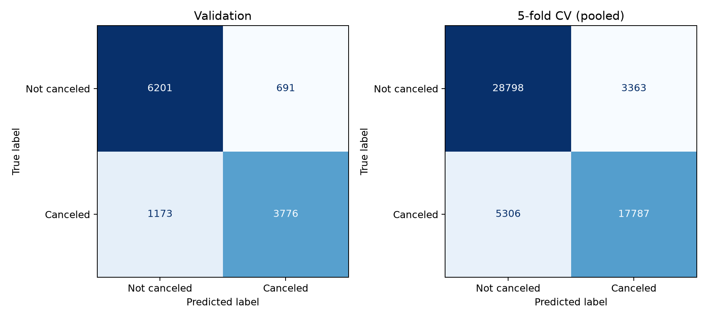

# XGBoost Regression and Classification — Milestone 1

**Course:** CSE382 — Introduction to Machine Learning

**Contributor:** Rodina — [Rodina761](https://github.com/Rodina761)

**Date:** 5 November 2026

**Repository:** https://github.com/Zareia/MachineLearning_Project_CSE382_Fall26

**Scope:** XGBoost contribution section for the team progress report; not the complete team submission.

## 1. Objective and completed work

Two untuned supervised models were implemented on City Hotel H2 only: XGBRegressor predicts Average Daily Rate (ADR), and XGBClassifier predicts whether a booking will eventually be canceled (IsCanceled). The models use library defaults with random_state=42; there is no parameter search, early stopping, class reweighting or decision-threshold optimization.

This contribution adds shared loading/configuration helpers, reusable notebook preprocessing, task-specific XGBoost pipelines, CLI training commands, validation and five-fold cross-validation results, saved fitted pipelines, and automated checks. Existing KNN and DBSCAN implementations and their stored results are preserved.

## 2. Data preparation and features

H2.csv contains 79,330 rows and 31 source columns. The loader checks this schema and population, parses NULL, preserves source row order, and treats agency/company identifiers as nominal information. No H1/Resort Hotel records are used.

The current teammate notebook, notebooks/Logistic regression_V2.ipynb, supplies the cleaning and feature choices. Its fixed rules remove Undefined MarketSegment and DistributionChannel rows and require Adults > 0. This removes 394 rows and retains 78,936 (99.50%). These are inherited eligibility restrictions, not proof that every excluded booking is erroneous. Duplicates and unusual ADR values are retained; 25,885 retained rows duplicate another complete source row.

The notebook-derived steps fill missing Country with Unknown, create TotalGuests and IsFamily, create hasCompany and hasAgent, create TotalNights, and group Country into the ten most frequent training countries plus Other. The top-ten list is learned inside the fitted pipeline, rather than from the full dataset. Raw party/stay/agency columns used to create these features are then omitted from the estimator, following the notebook.

Numeric estimator features: LeadTime, Adults, IsRepeatedGuest, PreviousCancellations, PreviousBookingsNotCanceled, RequiredCarParkingSpaces, TotalOfSpecialRequests, TotalGuests, IsFamily, hasCompany, hasAgent, TotalNights.

Categorical estimator features: ArrivalDateMonth, Meal, Country, MarketSegment, DistributionChannel, ReservedRoomType, CustomerType.

Numeric missing values use training medians. Categorical missing values use a fixed Missing label, followed by one-hot encoding with unknown-category handling. Trees do not need the logistic notebook's standardization. The complete preprocessing and estimator are saved together in a sklearn Pipeline. A ColumnTransformer applies numeric and categorical processing. All fitted transformations are refitted within each cross-validation training fold.

## 3. Prediction point and leakage audit

The intended use case is prediction at booking creation. The original publication generally reconstructs attributes relative to day-before-arrival snapshots using change logs where available [1]. Therefore this dataset does not establish that all retained attributes are their original booking-time values. The results are exploratory and do not demonstrate leakage-free operational prediction at booking creation.

| Excluded field | Task | Reason |
|---|---|---|
| ReservationStatus | Both | Final booking outcome reveals future information. |
| ReservationStatusDate | Both | Date of the final status update occurs later in the booking lifecycle. |
| AssignedRoomType | Both | Ultimately assigned room can change after booking. |
| BookingChanges | Both | Counts amendments after the booking was created. |
| DaysInWaitingList | Both | Realized waiting duration is not known at booking creation. |
| DepositType | Both | Source Table 1 derives it from payments before arrival/cancellation, rather than merely an initial contractual policy. |
| IsCanceled | Regression | Future cancellation outcome; not an input for predicting ADR. |
| ADR | Classification | Derived from lodging transactions and staying nights; not established as the initial quoted rate. |

Each task's target is excluded from its own predictors. Arrival year, day and week are omitted to follow the notebook's feature selection; those omissions are not claims that calendar fields are intrinsically leaking. NULL agency/company identifiers indicate not applicable in the source and are represented by zero-valued presence flags. Retained stay/guest/request/history fields still require original-booking availability checks.

## 4. Experimental protocol

The seed and split settings come from config.yaml. Test rows are reserved first, then the development rows are split into training and validation. Each XGBoost task has 55,254 training rows, 11,841 validation rows and 11,841 reserved test rows. Classification stratifies both splits by IsCanceled.

Five-fold CV uses only the training partition: shuffled KFold for regression and StratifiedKFold for classification. Reported CV values are unweighted fold means and sample standard deviations (ddof=1). Saved final baseline pipelines are fitted on the 70% training partition only. Validation and reserved-test rows are never used to fit them. No reserved-test predictions or metrics are produced. Classification uses positive class 1 (canceled) and the default 0.5 decision threshold.

These are random row splits. Duplicate/near-identical bookings can occur across partitions, and customer relationships are not known. Scores may therefore be optimistic and do not measure future-period generalization. KNN currently uses a different feature set, retains all rows, and groups identical predictors in its holdout. The present results must not be used to rank KNN against XGBoost. The team must agree a common protocol before controlled model comparison; experiment-specific holdouts do not establish a globally shared untouched final test set. Previously inspected records cannot later be described as never inspected.

## 5. Preliminary results

### ADR regression

| Metric | Validation | Training CV mean +/- std |
|---|---:|---:|
| MAE | 12.3594 | 12.8341 +/- 0.2352 |
| RMSE | 18.8405 | 30.7629 +/- 15.6390 |
| R2 | 0.7659 | 0.4906 +/- 0.3598 |

### Cancellation classification

| Metric | Validation | Training CV mean +/- std |
|---|---:|---:|
| accuracy | 0.8426 | 0.8431 +/- 0.0054 |
| precision | 0.8453 | 0.8410 +/- 0.0067 |
| recall | 0.7630 | 0.7702 +/- 0.0094 |
| F1 | 0.8020 | 0.8040 +/- 0.0071 |
| ROC_AUC | 0.9228 | 0.9256 +/- 0.0034 |

Validation confusion matrix (rows actual; columns predicted):

| | Predicted not canceled | Predicted canceled |
|---|---:|---:|
| Actual not canceled | 6201 | 691 |
| Actual canceled | 1173 | 3776 |

Pooled training-CV confusion matrix:

| | Predicted not canceled | Predicted canceled |
|---|---:|---:|
| Actual not canceled | 28798 | 3363 |
| Actual canceled | 5306 | 17787 |



### Interpretation

1. Regression validation MAE is 12.36 rate units; RMSE 18.84 gives greater weight to larger mistakes, and validation R2 is 0.766.
2. Classification validation accuracy is 84.26%, F1 is 0.802, and recall is 0.763: about 76.3% of actual cancellations are detected at the default threshold.
3. Regression CV RMSE is 30.76 +/- 15.64; training includes ADR=5,400 and the large fold variation warrants investigation, without deleting records merely to improve the result.

## 6. Reproduction and saved outputs

From the repository root, install requirements.txt in a Python environment and run:

```bash
python main.py train --task regression --model xgboost
python main.py train --task classification --model xgboost
python -m pytest -q
```

The tested environment used Python 3.12.14 and numpy 2.5.4, pandas 3.1.1, scikit-learn 1.9.1, matplotlib 3.11.2, joblib 1.6.0, PyYAML 6.0.3, threadpoolctl 3.7.0, xgboost 3.4.1. The run used the CPU-only XGBoost distribution, which exposes the same Python estimators. Versions, data/notebook hashes, model parameters and timings are recorded in each task's metadata JSON.

- outputs/xgb_<task>_metrics.csv: validation and CV mean/std.
- outputs/xgb_<task>_cv_folds.csv: all five fold scores, including classification confusion counts.
- outputs/xgb_<task>_splits.csv: reproducible source-row partitions and CV fold assignments.
- outputs/xgb_<task>_features.csv and metadata JSON: actual encoded features and settings.
- outputs/xgb_classification_confusion_matrices.csv and PNG: validation and pooled-CV counts/figure.
- outputs/xgb_baseline_summary.md: concise result summary for integration into the team report.
- artifacts/xgb_<task>_pipeline.joblib: fitted preprocessing and estimator, generated locally and excluded from Git/submission ZIP.

Twelve automated checks passed. They cover existing KNN behavior, shared loading/configuration, training-only preprocessing, leakage exclusions, default model parameters, actual fit/score test boundaries, and saved-pipeline validation behavior. The two real XGBoost commands were executed, and reloading the saved pipelines reproduced their validation metrics. These checks are not an exhaustive verification of every project requirement.

## 7. Contribution and next steps

Rodina's work package is the two XGBoost baselines, shared missing helpers, reusable notebook adaptation, CLI evaluation, saved artifacts, validation/CV results, checks and this report section. Teammates' KNN, DBSCAN and exploratory notebooks remain their separate contributions. Each contributor must understand and review their own implementation; the team report still needs the confirmed full member names/IDs and overall contribution table.

Before model selection, agree a common population, feature-timing policy and split protocol with the team. Investigate unusual training records and duplication using documented policies. For Milestone 2, add the remaining model families so each task has at least three models, compare baseline/tuned versions using a declared search space and selection metric, perform PCA/LDA comparisons, and integrate saved-artifact inference into the final application. Final test evaluation follows frozen model choices and an honestly documented holdout history.

This contribution section should be combined with the team's EDA, clustering/classification/regression contributions, overall progress and remaining-work plan. It does not replace the complete team progress report or claim that the final multi-task application is complete.

## Reference

[1] Nuno António, Ana de Almeida and Luís Nunes. “Hotel booking demand datasets.” Data in Brief 22 (2019), 41–49. https://pmc.ncbi.nlm.nih.gov/articles/PMC6297060/ (specifications table, extraction procedure and Table 1).
